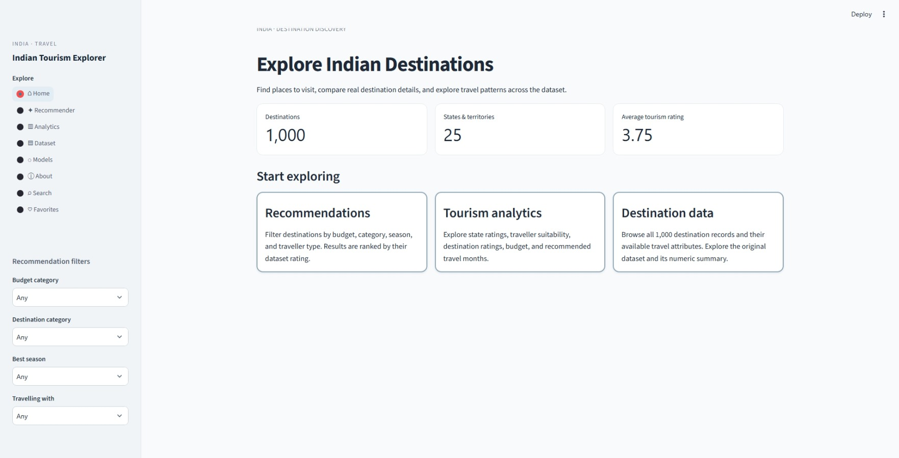
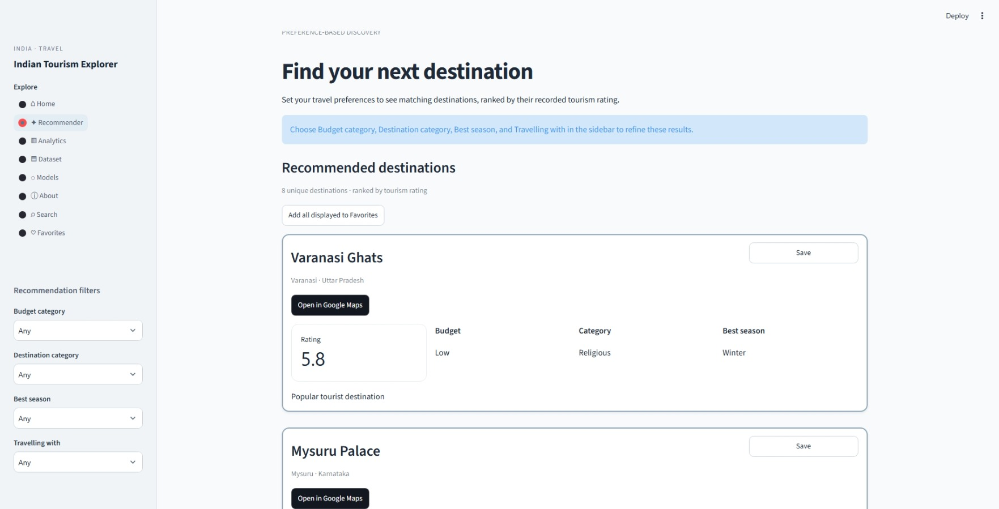

# Indian Tourism Explorer
## Tourist Destination Recommendation System

## Project Description

Indian Tourism Explorer is a data science project developed to help users discover suitable tourist destinations across India based on their travel preferences.

The application analyzes tourism-related attributes such as budget, destination category, best travel season, traveller type, destination ratings, and other destination characteristics to recommend suitable tourist destinations.

Built using Python and Streamlit, the application provides an interactive dashboard where users can search for destinations, explore tourism data, view analytics, save favourite destinations, and receive personalized recommendations through a user-friendly interface.

The application also integrates Google Maps links to help users view the geographical locations of recommended destinations.

---

## Problem Statement

Planning a trip often requires searching multiple websites to compare destinations based on budget, travel season, destination type, and traveller preferences. This process can be time-consuming and confusing.

The objective of this project is to simplify travel planning by:

- Recommending tourist destinations based on user preferences.
- Displaying detailed information about tourist destinations.
- Helping users make informed travel decisions using data analytics.
- Providing geographical location links through Google Maps.
- Offering an interactive and user-friendly web application.

---

## Features

### 1. Streamlit Dashboard

The application provides a dashboard with a sidebar titled **Indian Tourism Explorer**.

The sidebar contains the following navigation sections:

- **Home:** Introduction and overview of the application.
- **Recommender:** Generate personalized tourist destination recommendations.
- **Analytics:** Explore tourism data through interactive visualizations.
- **Dataset:** Browse the original tourism dataset.
- **Models:** Explore information about the recommendation models and their methodology.
- **About:** View project information and details.
- **Search:** Search for tourist destinations and explore their information.
- **Favourite:** Access saved favourite destinations.

### 2. Recommendation Filters

The sidebar includes a dedicated **Recommendation Filters** section that allows users to refine destination recommendations according to their preferences.

The filters include:

- **Budget Category:** Select destinations according to the preferred budget.
- **Destination Category:** Filter destinations by tourism category.
- **Best Travel Season:** Choose destinations suitable for the preferred travel season.
- **Traveller Type:** Find destinations based on traveller suitability, such as family or adventure travel, where supported by the dataset.

These filters help users narrow down available destinations and discover options that match their travel preferences.

### 3. Destination Search

- Search for tourist destinations by name.
- Explore destination information using the available dataset.
- View details about a selected destination.

### 4. Personalized Recommendations

The recommendation system suggests tourist destinations based on the user's selected preferences.

The recommendation parameters include:

- Budget Category
- Destination Category
- Best Travel Season
- Traveller Type

The Streamlit application filters destinations using the selected preferences and ranks matching results according to the dataset's `Rating` column.

The notebook also contains a separate content-similarity prototype implemented using `CountVectorizer` and cosine similarity. This prototype is not selectable as a recommendation mode in the Streamlit application.

### 5. Google Maps Integration

The application provides a Google Maps link for recommended destinations so users can explore their geographical locations.

Using destination location information, users can:

- Open a destination's location in Google Maps.
- View the destination's geographical position.
- Explore the surrounding area and nearby places through Google Maps.
- Use the map to support further travel planning.

The dataset includes `Latitude` and `Longitude` fields that can support location-based mapping when these coordinates are used by the application.

### 6. Interactive Data Analytics

The analytics dashboard provides visual insights into the tourism dataset, including:

- State-wise Average Tourism Rating
- Recommended Months Distribution
- Rating Distribution
- Budget Analysis
- Other available tourism-related visualizations

The displayed analytics depend on the visualizations implemented in the application.

### 7. Destination Information

The application can display the following destination attributes when available:

- Destination Name
- State
- City
- Rating
- Budget Category
- Budget Per Person
- Category
- Best Season
- Suitable For
- Adventure Level
- Food Cost Per Day
- Shopping Score
- Accessibility
- Ideal Duration
- Latitude
- Longitude
- Description

### 8. Favourite Destinations

The Favourite section allows users to access destinations saved through the application's favourite functionality.

### 9. Dataset Exploration

The Dataset section allows users to inspect the tourism dataset without intentionally changing its original column names or stored values.

---

## Dataset

The project uses a custom Indian Tourism Dataset containing approximately **1,000 tourist destinations** across India.

### Dataset Features

- Destination Name
- State
- City
- Category
- Budget Category
- Budget Per Person (INR)
- Rating
- Best Season
- Suitable For
- Adventure Level
- Popularity
- Food Cost Per Day (INR)
- Shopping Score
- Accessibility
- Ideal Duration
- Latitude
- Longitude
- Description

The dataset is cleaned, preprocessed, and explored through data analysis and feature engineering as part of the project workflow.

---

## Technologies Used

### Programming Language

- Python

### Libraries

- Pandas
- NumPy
- Matplotlib
- Scikit-learn
- Streamlit

### Development Tools

- Jupyter Notebook
- Visual Studio Code
- Git
- GitHub

### Mapping Integration

- Google Maps links for viewing destination locations

---

## Project Workflow

```text
Dataset Collection
        |
        v
Data Cleaning and Preprocessing
        |
        v
Exploratory Data Analysis (EDA)
        |
        v
Feature Engineering
        |
        v
Data Visualization
        |
        v
Preference-Based Recommendation System
        |
        v
Destination Filtering and Rating-Based Ranking
        |
        v
Google Maps Location Links
        |
        v
Streamlit Web Application
        |
        v
Personalized Tourist Destination Discovery
```

---

## Recommendation System

The project implements a preference-based recommendation system that suggests destinations according to user selections.

### Recommendation Process

1. Dataset Collection
2. Data Cleaning and Preprocessing
3. Feature Engineering
4. Exploratory Data Analysis
5. User Preference Selection
6. Filtering Destinations by Selected Preferences
7. Ranking Matching Destinations by Rating
8. Displaying Recommended Destinations
9. Providing Google Maps Links for Destination Locations

### Recommendation Parameters

The recommendation process considers:

- Budget Category
- Destination Category
- Best Travel Season
- Traveller Type

The system returns matching destinations ranked using the dataset's `Rating` column.

The notebook contains an additional content-similarity prototype using `CountVectorizer` and cosine similarity. This prototype is separate from the preference-based recommender currently available in the Streamlit application.

---

## Screenshots

### Home Page



### Destination Search


### Recommendation Results



### Analytics Dashboard


---

## Installation

Clone the repository:

```bash
git clone https://github.com/rajpreetsinghsekhon/Tourist-Destination-Recommendation-System.git
```

Move to the project directory:

```bash
cd Tourist-Destination-Recommendation-System
```

Install the required dependencies:

```bash
pip install -r requirements.txt
```

---

## How to Run

Run the Streamlit application:

```bash
python -m streamlit run app.py
```

The application will display a local URL in the terminal, usually:

```text
http://localhost:8501
```

Open this URL in your web browser to use the application locally.

---

## Project Structure

```text
Tourist-Destination-Recommendation-System/
|
├── app.py
├── README.md
├── requirements.txt
├── .gitignore
|
├── data/
|   └── Indian_Tourism_Dataset_1000.csv
|
├── notebooks/
|   └── Tourist_Recommendation_Destination_System.ipynb
|
└── images/
    ├── home.jpeg
    ├── destinationsearch.jpeg
    ├── recommendation.jpeg
    └── visualanalytics.jpeg
```

The actual folder and image filenames should match those present in the GitHub repository.

---

## Future Scope

Future enhancements for this project include:

- Integration with live tourism APIs.
- Hotel recommendation system.
- Flight booking integration.
- Weather forecasting.
- Nearby attractions recommendation.
- Restaurant recommendation.
- Interactive destination maps.
- Destination image gallery.
- User authentication and user profiles.
- AI-powered travel chatbot.
- Trip itinerary generation.
- Mobile application deployment.

---

## Live Demo

Explore the deployed application:

[Indian Tourism Explorer – Live Demo](https://tourist-destination-recommendation-system.streamlit.app/)

## GitHub Repository

View the project source code:

https://github.com/rajpreetsinghsekhon/Tourist-Destination-Recommendation-System

## Author

**Rajpreet Singh Sekhon**

B.Tech Computer Science and Engineering

Guru Nanak Dev Engineering College, Ludhiana

GitHub: [rajpreetsinghsekhon](https://github.com/rajpreetsinghsekhon)

LinkedIn: [Rajpreet Singh](https://www.linkedin.com/in/rajpreet-singh-37b216301/)

---

## License

This project is developed for educational and learning purposes.
